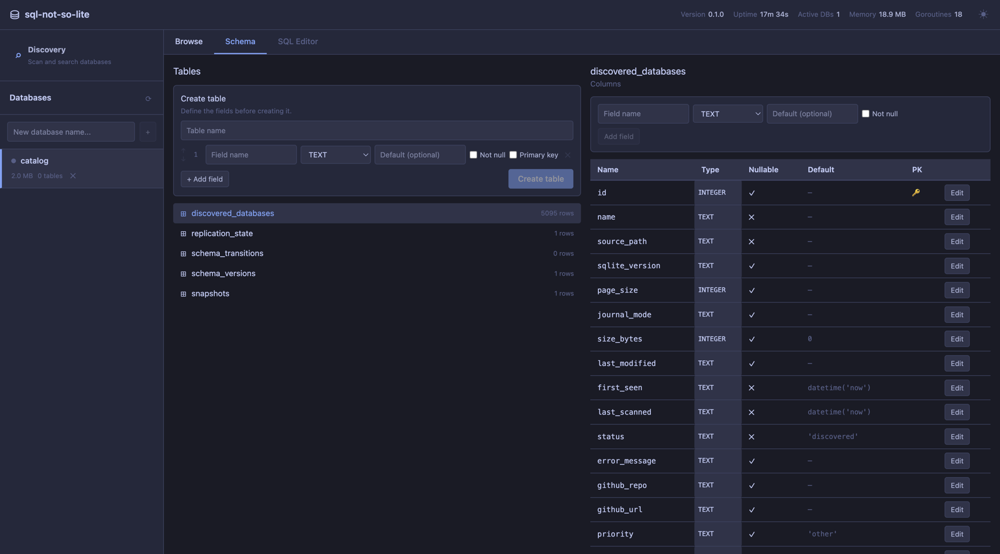

# sql-not-so-lite

[Documentation](docs/README.md) | [Issues](https://github.com/mbianchidev/sql-not-so-lite/issues) | [Releases](https://github.com/mbianchidev/sql-not-so-lite/releases)



*Browse tables and edit managed database schemas in the embedded web UI.*

A local SQLite manager for application developers. Run one daemon to manage SQLite files through gRPC or REST, explore data in a browser, and find existing databases across your development directories.

Managed databases support writes. Discovered databases stay at their original paths and have a separate read-only inspector; discovery does not import or move them.

## Contents

[Quickstart](#quickstart) | [Why sql-not-so-lite](#why-sql-not-so-lite) | [How it works](#how-it-works) | [Get started](#get-started) | [Features](#features) | [Documentation](#documentation) | [AI policy](#ai-policy) | [Contributing](#contributing) | [License](#license)

## Quickstart

Supports **macOS and Linux, AMD64 and ARM64**. Source builds need Git, Make, **Go 1.27.3+**, and **Node.js 22.13+ within 22.x, or 24+**, with npm.

Current releases contain source archives only. Build the complete application:

```bash
git clone https://github.com/mbianchidev/sql-not-so-lite.git
cd sql-not-so-lite
make all

mkdir -p "$HOME/sqnsl-scan"
SQNSL_SCAN_ROOT="$HOME/sqnsl-scan" ./sqnsl start
```

`make all` installs the locked frontend dependencies and embeds the built GUI in `./sqnsl`. The explicit scan root keeps the first run scoped to one directory.

Open **[http://localhost:9147](http://localhost:9147)**. In another terminal, verify the daemon:

```bash
curl -fsS http://localhost:9147/api/health
# {"status":"ok","version":"dev"}
```

Stop it with **Ctrl+C**. See [installation](docs/installation.md) for a persistent binary, user services, Docker, and troubleshooting.

> **Trusted environments only:** HTTP and gRPC listen on all network interfaces without built-in authentication or TLS. Run as your normal user and restrict network access. Without an explicit scan root, the daemon scans your home directory.

## Why sql-not-so-lite

- **Keep SQLite files portable.** Each managed database is a standard `.sqlite` file, not a separate database-server installation.
- **Use one interface for development data.** Browse managed data and inspect existing SQLite files without moving the originals.
- **Choose your client.** Use the embedded browser UI, a typed gRPC client, or the REST API.

## How it works

The `sqnsl` daemon serves gRPC on port **50051** and the GUI/REST API on **9147**. It stores managed files and discovery metadata locally, closes idle database connections, and can maintain local replicas of selected discovered databases.

Discovery and replication operate only on files the process can access. Local replicas and stored snapshots are not remote replication, high availability, or arbitrary point-in-time recovery. See the [usage guide and limitations](docs/usage.md).

## Get started

Create a database from the GUI sidebar, then use **Browse**, **Schema**, or **SQL Editor**. To inspect existing files, open **Discovery** and scan a directory.

Run `./sqnsl config init` once to create `~/.sql-not-so-lite/config.toml`. Choose a persistent scan root before installing a service, then restart the daemon after configuration changes. TOML paths must be absolute; they do not expand `~` or `$HOME`.

Follow the [configuration reference](docs/configuration.md) for storage paths, scan intervals, and environment overrides, or the [API examples](docs/api.md) to connect an application.

## Features

- Create, list, query, and delete managed databases through gRPC or REST.
- Browse and insert rows, edit supported schemas, run SQL with Monaco, and export query results as CSV or JSON.
- Search discovered databases, inspect them read-only, preserve favorites, and show repository associations.
- Maintain local table-level replicas and restore stored snapshots, with the [current recovery and schema-history limits](docs/usage.md#replication-and-recovery).

## Documentation

- [User guides and reference index](docs/README.md)
- [Developer setup, architecture, and checks](docs/development.md)
- [Installation packages and release operations](docs/releases.md)

## AI policy

You are responsible for everything you contribute, including AI-assisted code, documentation, and assets. Review and test your contribution, and be able to explain what the code does and why it is needed.

## Contributing

Bug reports, documentation improvements, and focused pull requests are welcome. Read the [contribution workflow](docs/development.md#contributing), include reproduction steps and relevant checks, and use synthetic data rather than private application databases.

## License

[MIT](LICENSE).
