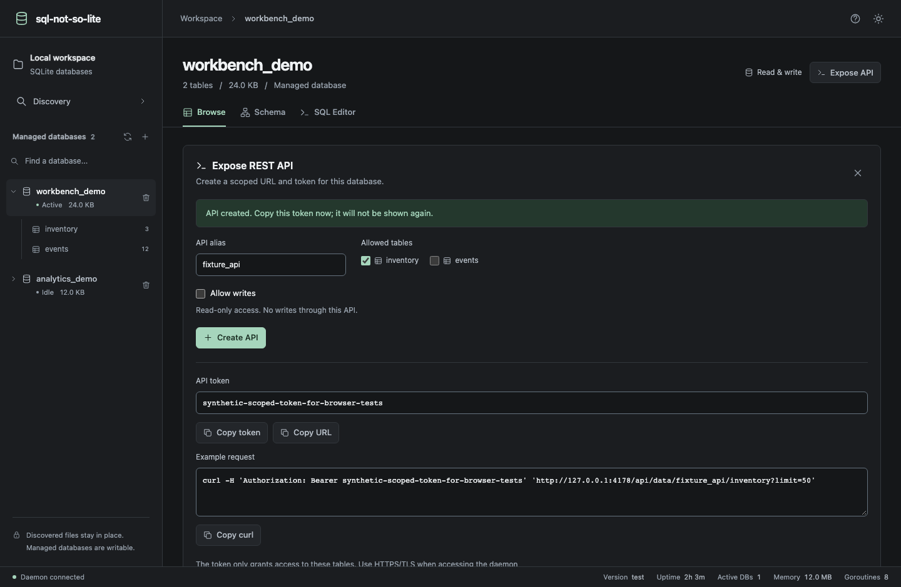
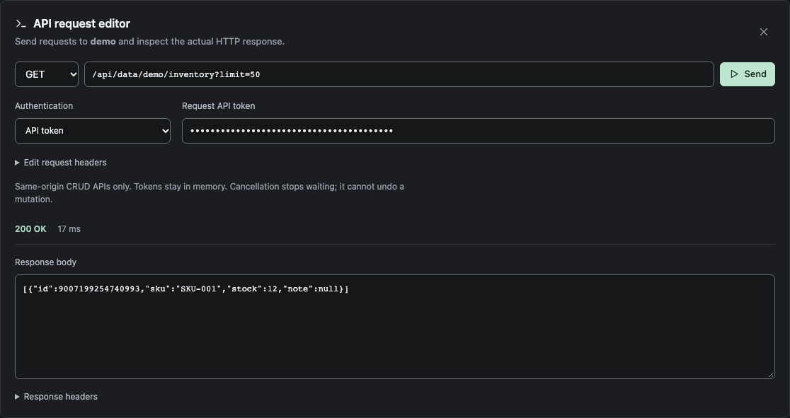

# SQLite CRUD APIs

[Documentation index](README.md) | [Authentication and listeners](configuration.md#authentication-and-network-access) | [REST reference](api.md)

Expose a managed database or a discovered SQLite file as a JSON API without writing SQL. APIs use stable aliases, explicit table allowlists, and individual bearer tokens. No separate server or database import is required.



## Create an API

In the GUI, select a managed database or open a discovered file's inspector, then choose **Expose API**. Enter an alias, select the tables, and optionally check **Allow writes**.

Read-only is the default for both database kinds. For discovered files, enabling writes changes the **original source file**, not a replica. Back up the file and coordinate with applications using it. The discovery inspector itself remains read-only.

Copy the API token when it is created. Tokens are shown once, stored as hashes in the catalog, and survive daemon restarts. **Rotate token** invalidates the previous token; **Revoke API** removes access without deleting the database. Deleting a database's catalog entry also revokes its APIs.

## Send requests inside the UI



Choose **Test API** after creating an API or beside an entry in **Active APIs**. The built-in request editor replaces the setup panel and starts with that API's URL and, when available, its one-time token.

Select **GET**, **POST**, **PATCH**, or **DELETE**, edit the URL/query parameters, and choose **Send**. POST/PATCH show a JSON body editor. Expand **Edit request headers** to supply a JSON object of string-valued headers.

Authentication defaults to a scoped **API token**. For an existing API, paste its token or rotate it to get a new one. Signed-in administrators can explicitly select **Admin session**; the editor never silently substitutes admin credentials for a missing/invalid scoped token.

The response view shows the real HTTP status, elapsed time, and raw response body, including 4xx/5xx errors. Expand **Response headers** to inspect headers. Bodies are displayed without JSON number coercion, so large integer literals remain exact.

Requests are restricted to this workspace's same-origin `/api/data/` routes. External URLs, management routes, URL credentials, and redirects are blocked. Set Authorization through the authentication controls rather than custom headers. Tokens, request bodies, and responses are not persisted to browser storage.

**Cancel** or closing the editor aborts pending work. Requests time out after 30 seconds; cancellation stops waiting but cannot undo a mutation already applied by the server. POST/PATCH bodies retain the API's 1 MiB limit. Response bodies are capped at 1 MiB with a visible truncation warning; use an external client for larger responses.

## Create an API through REST

The equivalent management request, with admin authentication enabled:

```bash
curl -fsS http://localhost:9147/api/exposures \
  -H "Authorization: Bearer $SQNSL_AUTH_TOKEN" \
  -H 'Content-Type: application/json' \
  -d '{"alias":"demo","managed_database":"myapp","tables":["inventory"],"writable":true}'
```

For a discovered file, replace `managed_database` with `discovered_id`, using its ID from `/api/discovered`. Do not send a filesystem path. API aliases start with a lowercase letter and contain at most 64 lowercase letters, digits, underscores, or hyphens.

The response contains `exposure` and a one-time `token`. Set `API_TOKEN` to that returned token for the following examples; do not use the admin token in an untrusted client.

## Read, create, update, and delete

Examples assume an `inventory` table with `id INTEGER PRIMARY KEY`, `sku TEXT`, and `stock INTEGER`.

```bash
# Read matching rows
curl -fsS --get http://localhost:9147/api/data/demo/inventory \
  -H "Authorization: Bearer $API_TOKEN" \
  --data-urlencode 'stock=gt.0' \
  --data-urlencode 'order=id.asc' \
  --data-urlencode 'limit=50'

# Create one row; omitted fields use SQLite defaults
curl -fsS http://localhost:9147/api/data/demo/inventory \
  -H "Authorization: Bearer $API_TOKEN" \
  -H 'Content-Type: application/json' \
  -d '{"sku":"SKU-004","stock":12}'

# Update one matching row
curl -fsS -X PATCH 'http://localhost:9147/api/data/demo/inventory?id=eq.7' \
  -H "Authorization: Bearer $API_TOKEN" \
  -H 'Content-Type: application/json' \
  -d '{"stock":20}'

# Delete one matching row
curl -fsS -X DELETE 'http://localhost:9147/api/data/demo/inventory?id=eq.7' \
  -H "Authorization: Bearer $API_TOKEN"
```

GET returns an array of row objects. POST returns the created row with status **201**; PATCH returns the updated row with **200**; DELETE returns **204** with no body.

PATCH and DELETE require filters matching exactly one row. No match returns **404**; multiple matches return **409** and the transaction is rolled back. Composite keys work by supplying equality filters for each key. Keyless ordinary tables expose an implicit `__sqnsl_rowid` field; inspect the schema endpoint for its exact name if a physical column uses that name.

## Filters and schema

| Parameter | Example | Meaning |
|-----------|---------|---------|
| Field filter | `stock=gte.10` | `eq`, `neq`, `gt`, `gte`, `lt`, `lte`, `like`, `in`, or `is` |
| Multiple filters | `stock=gte.1&stock=lt.10` | Conditions are combined with AND |
| NULL filter | `note=is.null` | SQL NULL; use `is.notnull` for non-NULL |
| Set filter | `id=in.(1,2,3)` | At most 100 values |
| Explicit field prefix | `filter.limit=eq.7` | Filter a field whose name conflicts with a reserved parameter |
| Projection | `select=id,sku` | Return selected fields |
| Ordering | `order=stock.desc,id.asc` | Order by fields, with keys added as tie breakers |
| Pagination | `limit=50&offset=100` | Default 100 rows, maximum 1,000; offset is bounded |

Filters, projection, ordering, pagination, and identifiers are validated against the live schema. Values are bound parameters, never SQL fragments. The schema endpoint is `GET /api/data/:alias`, authenticated with the same API token; it returns only allowed tables, their fields, keys, and read-only state.

Views and virtual tables can be read but cannot be mutated through this API. SQLite internal tables and the daemon's own catalog are not exposable. Generated fields cannot be written.

## Data and access limits

- Numbers and SQL NULL retain their JSON types. Text containing `"NULL"` remains text. Large integers are emitted exactly as JSON integer literals; JavaScript clients needing full int64 precision must use a lossless decoder.
- BLOB values use base64 strings for reads and writes. Structured objects/arrays are not field values; encode JSON explicitly into a TEXT field when needed.
- Each POST/PATCH body must be one JSON object, bounded to 1 MiB. Bulk writes, upsert, joins, arbitrary SQL, and schema changes are not part of this façade.
- Table allowlists restrict direct API access, not schema-defined triggers or foreign-key cascades. Normal SQLite constraints and side effects still apply.
- Missing source files are not recreated. Database operations have a timeout; lock/contention failures return **503** instead of claiming success.
- The daemon opens discovered files in existing-file mode and does not force their journal mode.

## Management and authentication

| Method | Path | Purpose |
|--------|------|---------|
| GET, POST | `/api/exposures` | List or create APIs |
| GET, PUT, DELETE | `/api/exposures/:alias` | Inspect, update table/write settings, or revoke an API |
| POST | `/api/exposures/:alias/token` | Rotate the API token |

Management endpoints and raw SQL use the **admin token** when configured. Scoped API tokens cannot use those endpoints or gRPC. A valid admin token can use the CRUD endpoints too, but the selected API's table/write restrictions still apply there.

Listeners default to loopback. External binds require admin authentication for HTTP **and** gRPC, including reflection. Authentication is not encryption: use HTTPS and gRPC TLS through a trusted terminating proxy, and restrict direct access to plaintext backend ports. See [configuration](configuration.md#authentication-and-network-access).
